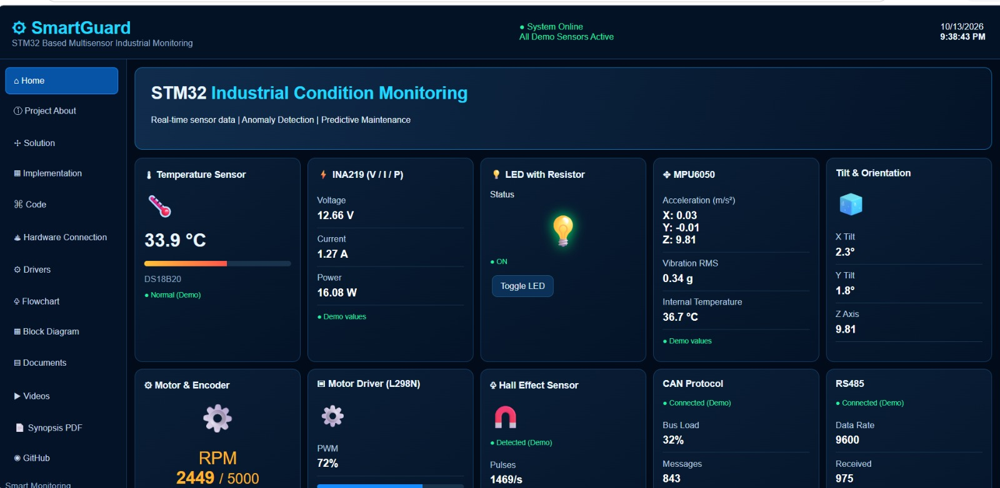
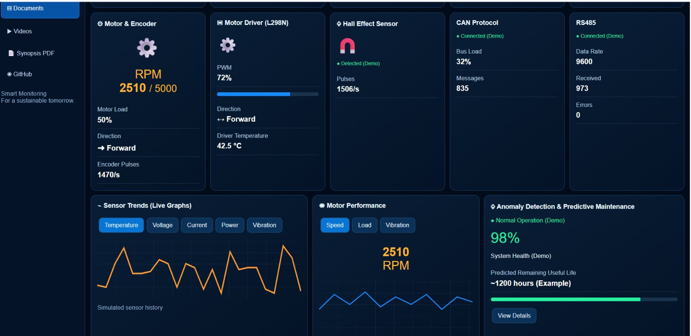
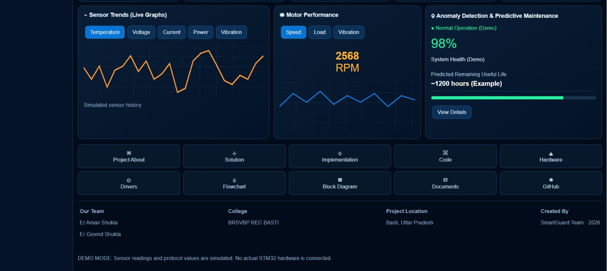

# Project Website

This folder contains the completed frontend UI/UX for the **STM32-Based Multisensor Industrial Condition Monitoring, Anomaly Detection, and Predictive Maintenance Using TinyML** project.

The website frontend has been developed with a dashboard overview, sensor-monitoring panels, and an anomaly-detection interface. The current focus is on completing and validating the hardware system, followed by backend and live-data integration.

## Website Screenshots

The screenshots below show the website interface developed for the project.

### 1. Dashboard Overview

This view presents the overall monitoring dashboard and its main status panels.

### 2. Sensor Monitoring

This view presents the interface for displaying readings from different sensors and monitoring subsystems.

### 3. Anomaly Detection

This view presents the dashboard interface intended for anomaly-related information as the detection workflow is developed and validated.

## Technologies and Tools

- **HTML** structures the website and dashboard content.
- **CSS** defines the layout, visual design, and responsive appearance.
- **JavaScript** provides frontend interactions and dashboard behaviour.
- **Figma** may be used for interface planning and design refinement.
- **Grafana** is a possible future option for data visualisation; it is not currently claimed as an integrated feature.

## Current Development Status

**Frontend UI/UX: completed.** The website interface and dashboard views have been developed.

**Hardware implementation: in progress.** The physical monitoring system and its sensor/firmware behaviour are being completed and validated.

**Backend and live-data integration: pending.** The website is not yet confirmed to be receiving live measurements from the STM32 hardware through a deployed backend or gateway.

**Important:** Any sensor values, charts, status indicators, or anomaly-related outputs currently shown in the dashboard should be treated as simulated/demo data unless that specific feature has been connected to the hardware and verified. The interface itself does not demonstrate that live telemetry, data storage, or TinyML inference is operational.

## Planned Hardware-to-Website Data Integration

After the hardware implementation and validation stage, the next step is to connect the STM32 NUCLEO-F446RE system to the website through a backend and an appropriate communication path. An ESP32 Wi-Fi gateway is one option under consideration; the final design will depend on the selected implementation.

Proposed data path:

1. The STM32 acquires and processes measurements from the available sensors.
2. The STM32 sends formatted measurement data over a serial interface such as UART.
3. A gateway, such as an ESP32 or a computer connected over USB serial, forwards the data to a backend service.
4. The backend exposes the received measurements to the website, for example through a WebSocket or API connected to an MQTT-based data pipeline.
5. The website updates its sensor cards, trend graphs, and connection status using received data.

The exact gateway, backend, message format, and deployment arrangement will be documented once selected and implemented. This is a planned integration workflow, not a claim that the full path is already working.

**The current milestone is frontend completion, with hardware implementation in progress and backend/live-data integration to follow.** Live monitoring, persistent data storage, authentication, remote access, and validated anomaly-detection/TinyML outputs will only be claimed after implementation and testing.

See [Live Hardware Data Integration Plan](docs/LIVE_HARDWARE_DATA_INTEGRATION.md) for the proposed architecture and implementation stages.

## Folder Structure

- `index.html` — main website entry page.
- `code/` — dashboard source code and related notes.
- `images/` — website screenshots and project images.
- `assets/` — additional website resources, as needed.
- `docs/` — project documents, including the live-data integration plan.

## Next Steps

1. Complete and validate the physical hardware and firmware.
2. Define and implement the hardware-to-backend communication path.
3. Integrate the backend with the website and replace demo values with verified hardware data.
4. Test live updates, connection/error states, and data handling end to end.
5. Document anomaly-detection and TinyML results after validation with collected data.

The README will be updated as hardware validation and backend integration progress.
